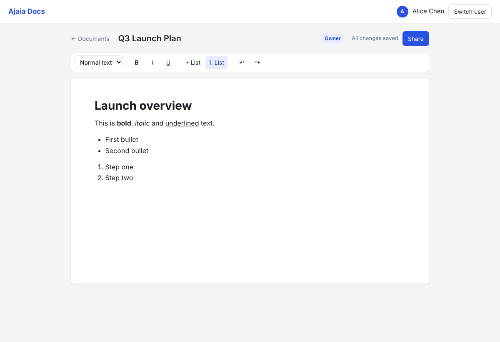

# Ajaia Docs

A lightweight collaborative document editor: create and format documents in the browser,
import files, and share them with other people as viewers or editors.

Built for the Ajaia "AI-Native Full Stack Developer" assignment with Next.js, SQLite and Tiptap.

- **Live demo:** https://ajaia-ai-llc-native-full-stack-developer-assignm-production.up.railway.app
- **Walkthrough video:** https://www.loom.com/share/8fb1c25f0d5b46c788ec5bb26293140b
- **Architecture and tradeoffs:** [`ARCHITECTURE.md`](ARCHITECTURE.md)
- **AI workflow note:** [`AI_WORKFLOW.md`](AI_WORKFLOW.md)
- **What is in this submission:** [`SUBMISSION.md`](SUBMISSION.md)
- **How it maps to the brief:** [`EVALUATION.md`](EVALUATION.md)



## Demo accounts

Sign-in is a demo flow: pick an account on the sign-in page, no password.

| Account | Email | Starts with |
| --- | --- | --- |
| Alice Chen | alice@ajaia.test | Owns "Welcome to Ajaia Docs" |
| Bob Martinez | bob@ajaia.test | Can edit Alice's welcome document |
| Carol Singh | carol@ajaia.test | Nothing (useful for checking that unshared documents stay private) |

To see two people at once, sign in as Alice in one browser window and as Bob in a private window.

## Run it locally

Requires **Node.js 22 or newer** (the SQLite driver needs it). Nothing is compiled during install:
the driver ships prebuilt binaries for macOS, Linux and Windows.

```bash
npm install
npm run dev
```

Open http://localhost:3000. The SQLite database is created automatically at `./data/app.db`
and seeded with the three demo accounts and a welcome document. Delete the `data` folder to
start over. No environment variables are needed locally (see [`.env.example`](.env.example)).

Production mode: `npm run build && npm start`.

## A five-minute tour for reviewers

1. **Create and edit.** Sign in as Alice, click **New document**, rename it by editing the title,
   and try bold, italic, underline, headings and both list types (toolbar or Ctrl/Cmd+B, I, U).
2. **Persistence.** Changes save automatically (watch "All changes saved"; Ctrl/Cmd+S saves at once).
   Reload the page: content and formatting are still there.
3. **Import a file.** On the dashboard click **Import file** and choose a `.txt`, `.md` or `.docx`
   file. It becomes a new editable document named after the file. Samples are in
   [`e2e/fixtures`](e2e/fixtures).
4. **Share.** Open a document you own, click **Share**, pick Bob and choose *Can edit* or *View only*.
5. **See the other side.** Sign in as Bob (private window). The document is under **Shared with me**
   with a *Can edit* / *View only* badge and its owner. View-only documents cannot be edited.
6. **Privacy.** Sign in as Carol and paste the document's URL: she gets "Document not found".
7. **Two editors.** Open the same document as Alice and Bob. Type as Bob, then type as Alice without
   reloading: Alice is warned that the document changed and chooses whether to load Bob's version
   or overwrite it. Nothing is overwritten silently.

## What works

| Area | Details |
| --- | --- |
| Documents | Create, rename, edit, delete (owner only), autosave, reopen |
| Formatting | Bold, italic, underline, headings 1 to 3, bulleted and numbered lists, undo/redo |
| File import | `.txt`, `.md` and `.docx` up to 2 MB become a new document. Other types are rejected with a clear message |
| Sharing | Owner grants access to another user as viewer or editor, changes the role, or removes access |
| Owned vs shared | Separate dashboard sections with Owner / Can edit / View only badges and the owner's name |
| Persistence | SQLite. Documents, formatting and shares survive refreshes and restarts |
| Safety nets | Access checks on every request, input validation, HTML sanitizing, conflict detection, friendly errors |

**Supported import types:** `.txt` (blank lines become paragraphs), `.md` (headings, emphasis, lists,
links, quotes, code) and `.docx` (headings, bold, italic, lists, links). Images, tables and
fonts/colours in imported files are dropped; the text of a table is kept. Text and Markdown files
can be UTF-8 (with or without a byte-order mark) or UTF-16, as Windows tools often save them.

## Tests

```bash
npm test          # 22 unit tests: access rules, sharing, validation, sanitizing, conflicts, import, persistence
npm run typecheck
```

There is also an optional browser run that drives the real UI through every flow above (79 checks).
It needs Google Chrome and a fresh database:

```bash
npm run build
DATABASE_PATH=/tmp/ajaia-e2e.db npm start     # terminal 1
npm run test:e2e                              # terminal 2
```

## Deployment

The app is a single Node process plus one SQLite file, so the host needs a disk that survives
restarts.

| Variable | Purpose | Default |
| --- | --- | --- |
| `DATABASE_PATH` | Location of the SQLite file | `./data/app.db`, or the attached volume on Railway |
| `SESSION_SECRET` | Signs the session cookie. Set a long random value | insecure development default |
| `PORT` | Port to listen on | `3000` |

**Railway (recommended; works on the trial plan)**

1. New Project, then *Deploy from GitHub repo*, and pick this repository. Railway detects Node,
   runs `npm run build` and starts with `npm start`.
2. Add a **Volume** to the service (right-click the project canvas or use the command palette) with
   mount path `/data`. The app finds it through `RAILWAY_VOLUME_MOUNT_PATH` and stores `app.db` there.
3. Add the variables `SESSION_SECRET` (any long random string) and `PORT` = `8080`.
4. In the service's Settings, under Networking, generate a public domain with target port `8080`
   and open it.

**Render**

[`render.yaml`](render.yaml) describes a Starter instance with a 1 GB persistent disk
(*New, Blueprint, pick the repository*). Render's Free plan also runs the app, but its filesystem is
ephemeral: the data resets to the seed whenever the service restarts or sleeps. The comments in
`render.yaml` explain how to switch.

## Scope: what was left out, and what comes next

Deliberately not built (see [`ARCHITECTURE.md`](ARCHITECTURE.md) for the reasoning):

- Live co-editing. Two people can edit the same document, and conflicting saves are detected, but
  changes are not merged or pushed to other open windows.
- Real accounts. Sign-in is a demo account picker; there are no passwords or sign-up.
- Comments, suggestions, version history, export, images, tables, search.

With another 2 to 4 hours, in this order:

1. Presence and live refresh, so collaborators see each other's edits without reloading.
2. Version history with restore (the content version counter is already in place).
3. Real authentication and inviting people by email.
4. Export to Markdown and PDF.

## Project layout

```
app/                  Pages, server actions and API routes (Next.js App Router)
  api/documents/      Documents and shares endpoints
  api/import/         File upload that creates a document
  doc/[id]/           Editor page
  login/              Demo sign-in
components/           Dashboard, DocEditor, ShareDialog, Header
lib/                  db (schema and seed), documents (all access rules), importFile, sanitize, auth, http
tests/                Unit tests (Vitest)
e2e/                  Browser checks and sample files to import
docs/screenshots/     Screenshots of each screen
```
